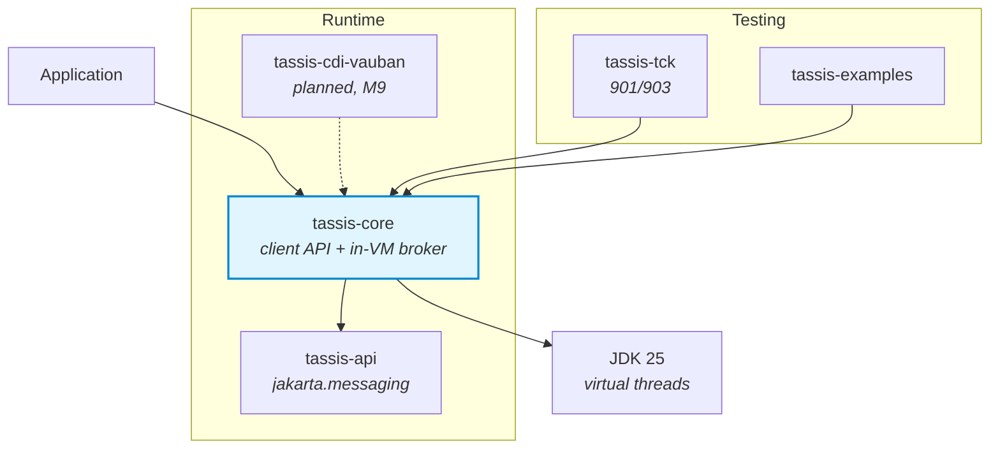

<p align="center">
  
</p>

<h1 align="center">Tassis</h1>

<p align="center">
  <strong>A Jakarta Messaging 3.1 provider with a broker of its own</strong><br>
  <a href="https://jakarta.ee/specifications/messaging/3.1/">Jakarta Messaging 3.1</a> | JDK 25 | Java Modules | Virtual Threads | Zero third-party dependency
</p>

<p align="center">
  
  
  
  
  
</p>

---

## What is Tassis?

Tassis is an implementation of [Jakarta Messaging 3.1](https://jakarta.ee/specifications/messaging/3.1/)
(the specification formerly known as JMS) for the [Vidocq](https://codefloe.com/Vidocq/vidocq)
ecosystem. It is a **provider**, not a client for another product: queues, topics, subscriptions,
acknowledgement, local transactions, selectors and redelivery are implemented here, in a broker
that today runs inside the JVM of the application.

### Why the name Tassis?

Every brick of Vidocq carries the name of someone whose work resembles its own. For messaging,
that is the **Tassis** family.

In 1490 Maximilian I of Habsburg entrusted Francesco de Tassis (Franz von Taxis), from a family
of couriers of Cornello near Bergamo, with a line of mounted couriers between Innsbruck and his
court in the Low Countries. In 1505 a contract with Philip the Handsome turned it into a network:
fixed routes from Brussels to Innsbruck, to the French court and to Spain, and delivery times
written into the contract (five and a half days from Brussels to Innsbruck in summer, six and a
half in winter). The family, known from 1650 as Thurn und Taxis, ran the post of the Holy Roman
Empire and then its own until 1867.

What they invented is what a messaging provider does:

| The Tassis post | Jakarta Messaging |
|---|---|
| The sender hands a letter to the post and goes back to work. It neither travels nor waits for the addressee to be home. | A producer sends a message and carries on. The consumer may be busy, or absent. |
| The letter goes from **relay** to relay. Each relay keeps it until a fresh rider takes it over. | The broker stores the message until a consumer takes it: store and forward. |
| A letter has one addressee, on a known route. | A **queue**: each message goes to one consumer. |
| A slip travels with the bag, and each relay writes on it the hour the bag went through. | A message carries its **headers**: when it was sent, when it expires, whether it is being delivered again. |
| Delivery times are part of the contract. | Delivery mode, priority, expiration and delivery delay are part of the message. |
| The post horn announces the courier before it arrives. | A **message listener** is called when a message arrives. |

The post horn of the logo is the emblem of that post, and is still the one of many European
postal services. The dotted circle around it is the road and its relays.

The spelling is the one the family used in the Low Countries and in Spain, *de Tassis*, between
the Italian *Tasso* and the German *Taxis*.

### Philosophy

- **Zero third-party dependency**: `tassis-core` compiles against `jakarta.jms-api` and nothing
  else. No CDI, no JNDI, no library; the message selector parser is written by hand.
- **A broker of its own**: in the JVM and in memory today, with a journal (M10) and a network
  transport (M11) on the roadmap.
- **Java Modules-first**: every artifact is an explicit Java module. `io.vidocq.tassis.core`
  exports one package, which holds the three classes an application names, and opens none.
- **Virtual threads**: the threads Tassis creates, for message listeners and completion
  listeners, are virtual. No `synchronized` around a blocking call, no `ThreadLocal`.
- **Tests first, the TCK as the contract**: each test cites the section of the specification it
  covers, and the official TCK runs from the reactor.

## Status

🚧 **In development, not released.** No artifact is published. Messages live in memory;
authentication and the network transport are not implemented yet. [ROADMAP.md](ROADMAP.md) has
the milestones, and the limits a user must know are in the
[reference](docs/en/modules/ROOT/pages/reference.adoc).

## Quick Start

### Prerequisites

- JDK 25 (Temurin)
- Maven 3.9.16
- `io.vidocq:vidocq-parent:0.4.0-SNAPSHOT` in the local Maven repository

```bash
# With SDKMAN!
sdk env
./mvnw -ntp clean install
```

An application then declares one dependency, `io.vidocq.tassis:tassis-core`, and one line in its
module descriptor:

```java
module com.acme.orders {
    requires io.vidocq.tassis.core;
}
```

### Send and receive (simplified API)

```java
ConnectionFactory factory = new TassisConnectionFactory();

try (JMSContext context = factory.createContext()) {
    Queue queue = context.createQueue("orders");

    context.createProducer().send(queue, "hello");

    String body = context.createConsumer(queue).receiveBody(String.class, 5_000);
}
```

The connection factory and the destinations are created with `new`, not looked up in JNDI; the
rest is the standard `jakarta.jms` API. A queue or a topic exists from its first use.

### The same with the classic API

```java
ConnectionFactory factory = new TassisConnectionFactory();

try (Connection connection = factory.createConnection()) {
    Session session = connection.createSession();
    Queue queue = session.createQueue("orders");
    MessageProducer producer = session.createProducer(queue);
    MessageConsumer consumer = session.createConsumer(queue);
    connection.start();

    producer.send(session.createTextMessage("hello"));

    TextMessage received = (TextMessage) consumer.receive(5_000);
}
```

### Publish and subscribe

```java
try (JMSContext context = factory.createContext()) {
    Topic prices = context.createTopic("prices");
    JMSConsumer subscriber = context.createConsumer(prices, "currency = 'EUR'");

    context.createProducer().setProperty("currency", "EUR").send(prices, "1.08");

    String price = subscriber.receiveBody(String.class, 5_000);
}
```

The runnable versions are in
[tassis-examples](tassis-examples/src/main/java/io/vidocq/tassis/examples); the build compiles
and runs them.

### Configuration

A connection factory is configured in code, from settings, or from a connection URL:

```java
// in code
ConnectionFactory inCode = new TassisConnectionFactory("orders").withClientID("reader");

// from settings: only the keys under "tassis." are read, so this works with -Dtassis.broker=orders
ConnectionFactory fromSettings = TassisConnectionFactory.from(System.getProperties());

// from a connection URL
ConnectionFactory fromUrl = TassisConnectionFactory.fromUrl("tassis:vm:orders?clientId=reader");
```

| Key | In a URL | Default | Meaning |
|---|---|---|---|
| `tassis.url` | | | A connection URL holding the settings below; a setting given by its own key overrides it |
| `tassis.broker` | `tassis:vm:<broker>` | `default` | The name of the in-VM broker |
| `tassis.clientId` | `clientId` | none | The client identifier of the connections |
| `tassis.listener.maxDeliveries` | `listener.maxDeliveries` | `10` | Deliveries of a message to a listener that keeps failing before the message is dropped |

Several factories can be defined by name, `tassis.factory.<name>.<key>`, and obtained with
`TassisConnectionFactory.named(name, settings)`; a named factory inherits the settings that carry
no name. An unknown key or an invalid value is an error that names the key.

## Architecture



```
tassis/
├── tassis-api            Aggregator: re-exposes jakarta.jms-api, a Java module upstream
├── tassis-core           The provider: administered objects, client API, in-VM broker,
│                         message model, selectors
├── tassis-cdi-vauban     Placeholder: JMSContext injection through Vauban (M9)
├── tassis-examples       The examples of the documentation, compiled and run by the build
├── tassis-bench          Placeholder: JMH benchmarks (M12)
└── tassis-tck            Official TCK runner, in-reactor behind the `tck` Maven profile
```

Inside `tassis-core`, only `io.vidocq.tassis.core` is exported (`TassisConnectionFactory`,
`TassisQueue`, `TassisTopic`). The rest is internal:

| Package | Role |
|---|---|
| `internal.client` | Connections, sessions, producers, consumers, browsers, and the simplified API as a thin layer over them |
| `internal.broker` | The in-VM broker: one storage per queue and per subscription, delivery, redelivery, expiration |
| `internal.message` | `Message` and the five body types, with one conversion table |
| `internal.selector` | The message selector language: parser, static checks, evaluation |
| `internal.settings` | What configures a connection factory: keys, URL, named factories |

## Jakarta Messaging 3.1 Features

| Feature | Status |
|---|---|
| Classic API (`Connection`, `Session`, `MessageProducer`, `MessageConsumer`) | ✅ |
| Simplified API (`JMSContext`, `JMSProducer`, `JMSConsumer`) | ✅ |
| Legacy domain-specific API (`QueueConnection`, `TopicSession`, ...) | ✅ |
| The five message body types, `getBody`, property conversions | ✅ |
| Queues, topics, temporary destinations, `QueueBrowser` | ✅ |
| Subscriptions: unshared and shared, durable or not, `noLocal` | ✅ |
| Acknowledgement modes, local transactions, `recover`, redelivery | ✅ |
| Message selectors | ✅ |
| `MessageListener`, asynchronous send with `CompletionListener` | ✅ |
| Priority, expiration, delivery delay | ✅ |
| Persistence across a restart | M10 |
| Network transport, authentication | M11 |
| `JMSContext` injection with CDI | M9 |
| XA and JTA | M13 |

## TCK Validation

Tassis runs the official Jakarta Messaging TCK (`jakarta.tck:jms-tck:11.0.3`) from its reactor.

```
Functional tests :  901/903 of the applicable set (core 642/642, core20 259/261)
Signature test   :  passed
```

The two tests not passed are about authentication, due with M11. The `ee` tests need EJB or a
web container and do not apply to a Java SE provider. **Compatibility is not claimed**:
[TCK.md](TCK.md) is the working record.

```bash
./run-official-tck-messaging-3.1.sh             # the functional tests, about 13 minutes
./run-official-tck-messaging-3.1.sh signature   # the signature test of the API
```

## Documentation

| Document | Contents |
|----------|---------|
| [docs/en](docs/en/modules/ROOT/pages) | The Antora component: getting started, usage, concepts, internals, TCK status, reference, migration |
| [ROADMAP.md](ROADMAP.md) | Design decisions and milestones |
| [TCK.md](TCK.md) | TCK runner, score, deviations |
| [BUG.md](BUG.md), [BENCH.md](BENCH.md) | Bug and benchmark records |
| [CONTRIBUTING.md](CONTRIBUTING.md) | How to contribute |

## License

[EPL-2.0 OR EUPL-1.2 OR GPL-2.0-or-later](LICENSE), at your option. See also [NOTICE](NOTICE).
