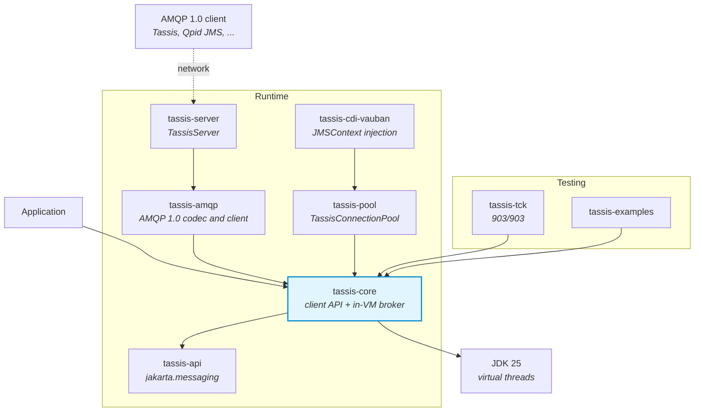

<p align="center">
  
</p>

<h1 align="center">Tassis</h1>

<p align="center">
  <strong>A Jakarta Messaging 3.1 provider with a broker of its own</strong><br>
  <a href="https://jakarta.ee/specifications/messaging/3.1/">Jakarta Messaging 3.1</a> | JDK 25 | Java Modules | Virtual Threads | Zero third-party dependency
</p>

<p align="center">
  
  
  
  
  
</p>

---

## What is Tassis?

Tassis is an implementation of [Jakarta Messaging 3.1](https://jakarta.ee/specifications/messaging/3.1/)
(the specification formerly known as JMS) for the [Vidocq](https://codefloe.com/Vidocq/vidocq)
ecosystem. It is a **provider**, not a client for another product: queues, topics, subscriptions,
acknowledgement, local transactions, selectors and redelivery are implemented here, in a broker
that today runs inside the JVM of the application.

### Why the name Tassis?

Every brick of Vidocq carries the name of someone whose work resembles its own. From 1490 the
**Tassis** family, later Thurn und Taxis, ran the relay post of the Habsburgs: a sender handed a
letter over and went back to work, each relay kept it until a fresh rider took it on, and the
delivery times were written into the contract. That is what a messaging provider does: store and
forward. The post horn of the logo is the emblem of that post. The whole story is in the
[documentation](docs/en/modules/ROOT/pages/index.adoc).

### Philosophy

- **Zero third-party dependency**: `tassis-core` compiles against `jakarta.jms-api` and nothing
  else. No CDI, no JNDI, no library; the message selector parser is written by hand.
- **A broker of its own**, in the JVM and entirely in memory: it writes nothing to the file
  system, by design. It can be opened to the network with AMQP 1.0, a standard protocol:
  the clients need nothing of Tassis.
- **Java Modules-first**: every artifact is an explicit Java module. `io.vidocq.tassis.core`
  exports one package, which holds the three classes an application names, and opens none.
- **Virtual threads**: the threads Tassis creates, for message listeners and completion
  listeners, are virtual. No `synchronized` around a blocking call, no `ThreadLocal`.
- **Tests first, the TCK as the contract**: each test cites the section of the specification it
  covers, and the official TCK runs from the reactor.

## Status

🚧 **In development, not released.** No artifact is published.

Messages live in memory and do not survive the JVM. That is a choice, not a gap: the broker
writes nothing to the file system.

The milestones are in [ROADMAP.md](ROADMAP.md), and the limits a user must know are in the
[reference](docs/en/modules/ROOT/pages/reference.adoc#limits).

## Quick Start

### Prerequisites

- JDK 25 (Temurin)
- Maven 3.9.16
- `io.vidocq:vidocq-parent:0.4.0-SNAPSHOT` in the local Maven repository

```bash
# With SDKMAN!
sdk env
./mvnw -ntp clean install
```

An application then declares one dependency, `io.vidocq.tassis:tassis-core`, and one line in its
module descriptor:

```java
module com.acme.orders {
    requires io.vidocq.tassis.core;
}
```

### Send and receive (simplified API)

```java
ConnectionFactory factory = new TassisConnectionFactory();

try (JMSContext context = factory.createContext()) {
    Queue queue = context.createQueue("orders");

    context.createProducer().send(queue, "hello");

    String body = context.createConsumer(queue).receiveBody(String.class, 5_000);
}
```

The connection factory and the destinations are created with `new`, not looked up in JNDI; the
rest is the standard `jakarta.jms` API. A queue or a topic exists from its first use.

### The same with the classic API

```java
ConnectionFactory factory = new TassisConnectionFactory();

try (Connection connection = factory.createConnection()) {
    Session session = connection.createSession();
    Queue queue = session.createQueue("orders");
    MessageProducer producer = session.createProducer(queue);
    MessageConsumer consumer = session.createConsumer(queue);
    connection.start();

    producer.send(session.createTextMessage("hello"));

    TextMessage received = (TextMessage) consumer.receive(5_000);
}
```

### Publish and subscribe

```java
try (JMSContext context = factory.createContext()) {
    Topic prices = context.createTopic("prices");
    JMSConsumer subscriber = context.createConsumer(prices, "currency = 'EUR'");

    context.createProducer().setProperty("currency", "EUR").send(prices, "1.08");

    String price = subscriber.receiveBody(String.class, 5_000);
}
```

### Injection with CDI

On [Vauban](https://codefloe.com/Vidocq/vauban), a bean has its contexts injected instead of
creating them. Add `io.vidocq.tassis:tassis-cdi-vauban` and
`requires io.vidocq.tassis.cdi.vauban;`, and give the container the beans of `TassisCdi.BEANS`:

```java
@Dependent
public class OrderDesk {

    @Inject
    JMSContext orders;

    @Inject
    @JMSConnectionFactory("audit")
    JMSContext audit;

    public void place(String order) {
        orders.createProducer().send(orders.createQueue("orders"), order);
        audit.createProducer().send(audit.createQueue("trail"), "placed " + order);
    }
}
```

An injected context lives for the request in progress: created on first use, shared by the
injection points that carry the same annotations, closed when the request ends. Its connection
factory is a `ConnectionFactory` bean of the application, or else the settings described below,
read from the system properties.

The runnable versions of the first three examples are in
[tassis-examples](tassis-examples/src/main/java/io/vidocq/tassis/examples); the build compiles
and runs them.

### Configuration

A connection factory is configured in code, from settings, or from a connection URL:

```java
// in code
ConnectionFactory inCode = new TassisConnectionFactory("orders").withClientID("reader");

// from settings: only the keys under "tassis." are read, so this works with -Dtassis.broker=orders
ConnectionFactory fromSettings = TassisConnectionFactory.from(System.getProperties());

// from a connection URL
ConnectionFactory fromUrl = TassisConnectionFactory.fromUrl("tassis:vm:orders?clientId=reader");
```

The settings are the name of the in-VM broker (`tassis.broker`) or the address of a broker of
the network (`tassis.server`), the client identifier, the redelivery limit of a listener, how
many messages a consumer fetches ahead, and those of the connection pool. Several factories can
be defined by name, `tassis.factory.<name>.<key>`. An unknown key or an invalid value is an
error that names the key.

Every key, its form in a URL and its default are in
[Configuration](docs/en/modules/ROOT/pages/reference.adoc#configuration).

### Authentication

A broker accepts anyone until a user is declared on it. From then on it is secured: a connection
needs the name and the password of a declared user.

```java
TassisBroker.named("orders").addUser("billing", password);

ConnectionFactory factory = new TassisConnectionFactory("orders");
try (JMSContext context = factory.createContext("billing", password)) {
    // ...
}
factory.createContext("billing", "wrong");   // JMSSecurityRuntimeException
factory.createContext();                      // refused too, unless allowAnonymous(true)
```

Users live in memory and every user has the same rights: see
[Authentication](docs/en/modules/ROOT/pages/usage.adoc#authentication).

### Opening the broker to the network

`TassisServer`, in `tassis-server`, opens a broker to other processes over AMQP 1.0:

```java
try (TassisServer server = TassisServer.forBroker("orders").port(5672).start()) {
    // any AMQP 1.0 client reaches the broker "orders" at amqp://this-host:5672
}
```

A Tassis client in another process reaches it by changing its URL, with `tassis-amqp` among its
dependencies. A client needs nothing of Tassis, though: any AMQP 1.0 client will do, Apache Qpid
JMS for instance.

```java
ConnectionFactory tassis = TassisConnectionFactory.fromUrl("tassis:amqp://broker-host:5672");

ConnectionFactory qpid = new org.apache.qpid.jms.JmsConnectionFactory("amqp://broker-host:5672");
```

A client of the network has the whole of Jakarta Messaging, short of XA.

**Nothing is encrypted unless asked.** The server listens on the loopback address unless told
otherwise, and encrypts with TLS when it is given a context; clients then say `amqps`. See
[Opening a broker to the network](docs/en/modules/ROOT/pages/usage.adoc#network) and
[Encrypting the connection](docs/en/modules/ROOT/pages/usage.adoc#tls).

### Pooling the connections

A connection to a broker of the network is a socket, a handshake and an authentication.
`TassisConnectionPool`, in `tassis-pool`, keeps them open: it is a `ConnectionFactory` whose
connections and contexts go back to the pool when the application closes them.

```java
try (TassisConnectionPool pool = TassisConnectionPool.over(factory).maxSize(8).build()) {
    try (JMSContext context = pool.createContext()) {     // borrowed
        context.createProducer().send(context.createQueue("orders"), "hello");
    }                                                     // given back, not closed
}
```

A pool opens ten connections at most by default. Its size, how long a borrower waits and how
long a connection is kept are set on the builder, by key (`tassis.pool.maxSize`) or in the URL
of the factory (`pool.maxSize`). Contexts injected with CDI come from a pool when their factory
reaches a broker of the network. See
[Pooling the connections](docs/en/modules/ROOT/pages/usage.adoc#pool).

## Architecture



```
tassis/
├── tassis-api            Aggregator: re-exposes jakarta.jms-api, a Java module upstream
├── tassis-core           The provider: administered objects, client API, in-VM broker,
│                         message model, selectors
├── tassis-amqp           AMQP 1.0, written from scratch: the codec and the mapping of messages
├── tassis-server         TassisServer: opens a broker to AMQP 1.0 clients
├── tassis-pool           TassisConnectionPool: a connection factory that lends its connections
├── tassis-cdi-vauban     JMSContext injection (§12.4) for applications on Vauban
├── tassis-cdi-vauban-module-it   Its proof on the module path; never published
├── tassis-examples       The examples of the documentation, compiled and run by the build
├── tassis-bench          JMH benchmarks, beside Artemis and Qpid JMS, behind the `bench`
│                         profile; never published
├── tassis-tck            Official TCK runner, in-reactor behind the `tck` Maven profile
└── tassis-interop        Tests against third-party AMQP implementations, behind the
                          `interop` profile; never published
```

Inside `tassis-core`, only `io.vidocq.tassis.core` is exported (`TassisConnectionFactory`,
`TassisQueue`, `TassisTopic`, and `TassisBroker` to administer a broker). The rest is internal:

| Package | Role |
|---|---|
| `internal.client` | Connections, sessions, producers, consumers, browsers, and the simplified API as a thin layer over them |
| `internal.broker` | The in-VM broker: one storage per queue and per subscription, delivery, redelivery, expiration |
| `internal.message` | `Message` and the five body types, with one conversion table |
| `internal.selector` | The message selector language: parser, static checks, evaluation |
| `internal.settings` | What configures a connection factory: keys, URL, named factories |

## Jakarta Messaging 3.1 Features

| Feature | Status |
|---|---|
| Classic API (`Connection`, `Session`, `MessageProducer`, `MessageConsumer`) | ✅ |
| Simplified API (`JMSContext`, `JMSProducer`, `JMSConsumer`) | ✅ |
| Legacy domain-specific API (`QueueConnection`, `TopicSession`, ...) | ✅ |
| The five message body types, `getBody`, property conversions | ✅ |
| Queues, topics, temporary destinations, `QueueBrowser` | ✅ |
| Subscriptions: unshared and shared, durable or not, `noLocal` | ✅ |
| Acknowledgement modes, local transactions, `recover`, redelivery | ✅ |
| Message selectors | ✅ |
| `MessageListener`, asynchronous send with `CompletionListener` | ✅ |
| Priority, expiration, delivery delay | ✅ |
| Persistence across a restart | Not planned: the broker is in memory by design |
| Authentication (user registry per broker, `TassisBroker`) | ✅ |
| A broker open to AMQP 1.0 clients: queues, topics and subscriptions, selectors, temporary destinations, local transactions, browsers | ✅ |
| The Tassis client over AMQP (`tassis:amqp://host`), with heartbeats and the `ExceptionListener` for a lost connection | ✅ |
| Over AMQP: TLS (`amqps`), for the server and for the Tassis client | ✅ |
| `JMSContext` injection with CDI, request scope (on Vauban) | ✅ |
| `JMSContext` injection in a JTA transaction | M13 |
| XA and JTA | M13 |

## TCK Validation

Tassis runs the official Jakarta Messaging TCK (`jakarta.tck:jms-tck:11.0.3`) from its reactor.

```
Functional tests :  903/903 of the applicable set (core 642/642, core20 261/261)
Signature test   :  passed
```

The `ee` tests need EJB or a web container and do not apply to a Java SE provider.
**Compatibility is not claimed**, which would take a certification request:
[TCK.md](TCK.md) is the working record.

```bash
./run-official-tck-messaging-3.1.sh             # the functional tests, about 13 minutes
./run-official-tck-messaging-3.1.sh signature   # the signature test of the API
```

## Documentation

| Document | Contents |
|----------|---------|
| [docs/en](docs/en/modules/ROOT/pages) | The Antora component: getting started, usage, concepts, internals, performance, TCK status, reference, migration |
| [ROADMAP.md](ROADMAP.md) | Design decisions and milestones |
| [TCK.md](TCK.md) | TCK runner, score, deviations |
| [BUG.md](BUG.md), [BENCH.md](BENCH.md) | Bug and benchmark records |
| [CONTRIBUTING.md](CONTRIBUTING.md) | How to contribute |

## License

[EPL-2.0 OR EUPL-1.2 OR GPL-2.0-or-later](LICENSE), at your option. See also [NOTICE](NOTICE).
